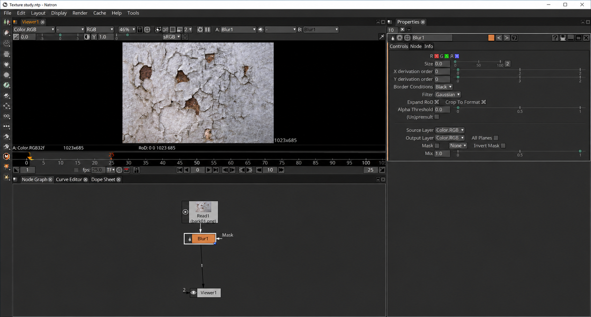
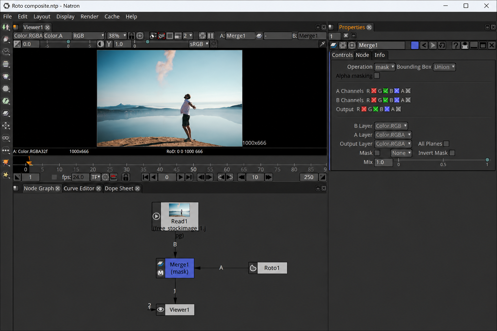
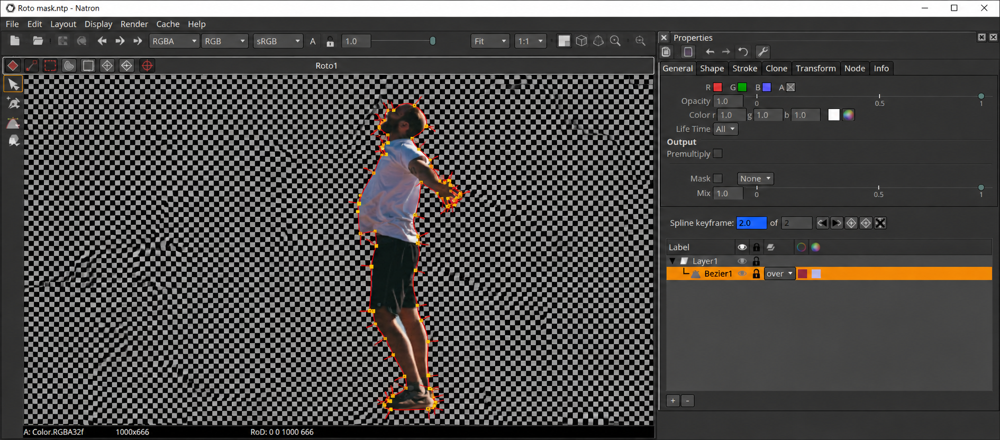

# Natron Compositor - Open-Source Node-Based VFX Compositing

Natron Compositor is free, cross-platform compositing software maintained by Natron Compositing. It provides a 32-bit floating-point image pipeline, node-based workflows, OpenFX integration, motion tracking, rotoscoping, animation, and command-line rendering for Windows and Linux.

Natron Compositor follows familiar workflows found in professional applications such as Nuke, Fusion, and After Effects while keeping the source available under GPLv2. See [COPYING](COPYING), [CHANGELOG.md](CHANGELOG.md), and the [user guide](Documentation/source/guide/index.rst).

[](https://natron-compositing.github.io/natron-compositor/natron-compositor)

## Natron Compositing Scope

natron compositor, natron compositing, natron software, natron vfx software, natron open source compositor, natron compositor software, compositing, visual-effects, node-based-compositing, openfx, vfx, image-processing, rotoscoping

## Help Wanted

Natron Compositing welcomes developers and maintainers interested in C++, Qt, OpenGL, Python, image processing, and OpenFX. Start with [CONTRIBUTING.md](CONTRIBUTING.md), follow [CODE_OF_CONDUCT.md](CODE_OF_CONDUCT.md), and review the main application entry point in [App/NatronApp_main.cpp](App/NatronApp_main.cpp).

Useful contribution areas include:

- Building Natron Compositor on a supported platform.
- Fixing focused Natron software defects.
- Improving Natron OpenFX plugins and host compatibility.
- Extending Natron rotoscoping, tracking, or image-processing tools.
- Improving the Natron compositing tutorial and user documentation.
- Testing Natron for Windows and Natron for Linux.
- Modernizing build, dependency, and continuous-integration support.

### Is natron still used today?

Yes. Natron Compositor remains useful today for artists who need a Natron open source compositor, a node-based image pipeline, OpenFX support, or scriptable batch rendering. Its practical suitability depends on the required plugins, operating system, graphics hardware, and the stability of the selected release.

Natron Compositing continues to provide source code, documentation, release history, and contribution guidance. The project also seeks additional maintainers, so users should review [CHANGELOG.md](CHANGELOG.md) and test their production workflow before committing important work to a particular build.

## Features



- **Floating-point processing:** Natron Compositor uses a 32-bit floating-point linear color-processing pipeline.
- **Color management:** Natron compositing workflows support OpenColorIO configurations and production color transforms.
- **Image and video formats:** OpenImageIO and FFmpeg integration enables common formats such as EXR, DPX, TIFF, JPEG, PNG, H.264, and DNxHR.
- **OpenFX hosting:** The Natron OpenFX host supports free, open-source, and commercial effects through the standardized OpenFX interface.
- **Node-based compositing:** [Node.cpp](Engine/Node.cpp) and [NodeGraph.cpp](Gui/NodeGraph.cpp) implement the graph-oriented foundation of the Natron node based compositor.
- **Interactive viewing:** [ViewerInstance.cpp](Engine/ViewerInstance.cpp) and [ViewerGL.cpp](Gui/ViewerGL.cpp) provide responsive zooming, panning, playback, and visual feedback.
- **Caching:** [Cache.cpp](Engine/Cache.cpp) supports RAM and disk caching for interactive Natron 2d compositing.
- **Animation:** The Natron Compositor interface includes a curve editor and dope sheet implemented by [CurveEditor.cpp](Gui/CurveEditor.cpp) and [DopeSheetEditor.cpp](Gui/DopeSheetEditor.cpp).
- **Rotoscoping and paint:** Natron rotoscoping is implemented around [RotoContext.cpp](Engine/RotoContext.cpp), [RotoPaint.cpp](Engine/RotoPaint.cpp), and [RotoPanel.cpp](Gui/RotoPanel.cpp).
- **Motion tracking:** Natron motion tracking uses [TrackerContext.cpp](Engine/TrackerContext.cpp), [TrackerNode.cpp](Engine/TrackerNode.cpp), and [TrackerPanel.cpp](Gui/TrackerPanel.cpp).
- **Multi-channel images:** Natron software can process layers and channels from multi-layer EXR material.
- **Headless rendering:** [Renderer/NatronRenderer_main.cpp](Renderer/NatronRenderer_main.cpp) provides the entry point for background and render-farm operation.
- **Python integration:** Natron Compositing supports expressions, callbacks, scripted node groups, and an integrated editor implemented in [ScriptEditor.cpp](Gui/ScriptEditor.cpp).
- **Recoverable workflows:** Project management, automatic saves, and separate rendering processes reduce the effect of application or rendering failures.

### What is compositing in VFX?

Compositing in VFX combines images, rendered elements, masks, color operations, and effects into a finished shot. A Natron node based compositor represents those operations as a graph in which each node reads, transforms, merges, masks, or writes image data.

Natron green screen compositing typically combines keying, edge treatment, color correction, transforms, masks, and background integration. Natron rotoscoping and Natron motion tracking help isolate subjects and attach corrections or effects to moving image features.

### Who is the best VFX editor?

There is no single best VFX editor for every production. Nuke is widely associated with high-end studio compositing, Blender covers a broad 3D creation pipeline, Gaffer focuses on configurable VFX scene workflows, and video editors emphasize timeline-oriented assembly.

Natron Compositor is a strong choice when the priority is free Natron vfx software, node-based 2D work, OpenFX compatibility, editable project data, and cross-platform rendering. The best choice still depends on required plugins, collaboration systems, color pipelines, support expectations, and artist experience.

### What is nuke software used for?

Nuke software is primarily used for professional node-based VFX compositing. Typical work includes combining rendered passes, keying green-screen footage, rotoscoping, tracking, paint, color adjustments, and preparing final shots.

Compatibility, proprietary tools, studio integration, and plugin behavior should be evaluated separately rather than assuming identical operation.

### Main Components

| Component | Role In Natron Compositor |
|---|---|
| Qt | Provides the cross-platform Natron software interface. |
| OpenFX | Defines the host and plugin interface used by Natron OpenFX plugins. |
| OpenColorIO | Provides production color-management support. |
| OpenImageIO | Supplies format-independent image input and output. |
| FFmpeg | Supplies video format and codec support. |
| Python | Enables automation, expressions, callbacks, and scripted workflows. |
| Google Test | Supports C++ unit testing. |
| Hoedown | Supplies lightweight Markdown processing. |
| HTTP parser and QHttpServer | Support asynchronous HTTP-related facilities without defining the core image pipeline. |
| gflags and glog | Support command-line configuration and logging in integrated components. |

## Requirements

Natron system requirements include a supported Windows or Linux system, an x86 or x86-64 processor, sufficient memory for the intended image resolution, and suitable storage for caches and source media.

An OpenGL 2.0-compatible graphics device is required for hardware-accelerated viewing and rendering. Software rendering may be available where compatible hardware or drivers are unavailable, but interactive performance will be lower.

> Large images, multi-layer EXR files, complex Natron OpenFX plugins, and concurrent graphs can significantly increase memory, cache, and processing requirements.

## Installing

### Binary Distribution

Use the download button near the beginning of this README for Natron Compositor.

### Building And Installing From Source

Natron Compositing provides both [CMakeLists.txt](CMakeLists.txt) and [Project.pro](Project.pro). The exact compiler, Qt version, Python environment, and dependency versions must match the branch being built.

A typical CMake build from an existing source checkout is:

```shell
cmake -S . -B build
cmake --build build --config Release
```

Natron for Windows commonly uses a Visual Studio or MSYS2-based environment. Natron for Linux may use a native toolchain or a controlled container-based SDK. macOS dependency work has historically used MacPorts, while Homebrew formulas have been useful for debugging older dependencies.

Dependency builds may pin versions when newer releases introduce ABI, API, runtime, or OpenMP regressions. Reproducible Natron Compositor builds should preserve those pins until their replacements are validated.



## Documentation

The [guide index](Documentation/source/guide/index.rst) organizes the Natron compositing tutorial, while [the introductory guide](Documentation/source/guide/intro.rst) explains the basic Natron software workflow.

Documentation sources use reStructuredText and may be rendered with Sphinx. OpenFX API material is generated separately from annotated C and C++ headers using Doxygen and documentation tooling.

## Structure

| Area | Important Files |
|---|---|
| Application lifecycle | [AppManager.cpp](Engine/AppManager.cpp), [AppInstance.cpp](Engine/AppInstance.cpp) |
| Projects and settings | [Project.cpp](Engine/Project.cpp), [Settings.cpp](Engine/Settings.cpp) |
| Nodes and effects | [Node.cpp](Engine/Node.cpp), [EffectInstance.cpp](Engine/EffectInstance.cpp) |
| OpenFX host | [OfxHost.cpp](Engine/OfxHost.cpp), [OfxEffectInstance.cpp](Engine/OfxEffectInstance.cpp) |
| Image pipeline | [Image.cpp](Engine/Image.cpp), [ImageConvert.cpp](Engine/ImageConvert.cpp), [ImageMaskMix.cpp](Engine/ImageMaskMix.cpp) |
| File input and output | [ReadNode.cpp](Engine/ReadNode.cpp), [WriteNode.cpp](Engine/WriteNode.cpp) |
| Curves and transforms | [Curve.cpp](Engine/Curve.cpp), [Transform.cpp](Engine/Transform.cpp) |
| Graphical interface | [Gui.cpp](Gui/Gui.cpp), [ProjectGui.cpp](Gui/ProjectGui.cpp), [NodeGui.cpp](Gui/NodeGui.cpp) |
| Global facilities | [GlobalDefines.h](Global/GlobalDefines.h), [MathUtils.h](Global/MathUtils.h), [PythonUtils.cpp](Global/PythonUtils.cpp) |

## Testing

Natron Compositing uses focused tests, compiler diagnostics, and runtime validation to protect the Natron Compositor pipeline. A configured CMake build can expose available tests through:

```shell
ctest --test-dir build --output-on-failure
```

Parser and file-loading changes should include malformed-input coverage. Crashes alone do not establish exploitability; reports should identify the triggering input, corrupted state, affected component, and confirmed impact.

## Contributing



Start with a contained change, build Natron Compositor locally, and verify the affected Natron compositing workflow. Larger changes should preserve project compatibility, OpenFX behavior, image semantics, thread safety, and cross-platform operation.

Before submitting work:

- Read [CONTRIBUTING.md](CONTRIBUTING.md).
- Follow [.clang-format](.clang-format), [.clang-tidy](.clang-tidy), and [.editorconfig](.editorconfig).
- Keep public behavior consistent unless the change is intentionally documented.
- Test Natron for Windows or Natron for Linux as applicable.
- Update [CHANGELOG.md](CHANGELOG.md) when user-visible behavior changes.
- Keep generated, cache, and local build files out of commits according to [.gitignore](.gitignore).

## Help Us

Security-sensitive problems in Natron Compositor should follow [SECURITY.md](SECURITY.md). Reports should include reproducible technical evidence and avoid publishing confidential vulnerability details before a correction is available.

General project conduct is defined by [CODE_OF_CONDUCT.md](CODE_OF_CONDUCT.md). Contributors to Natron Compositing are listed in [AUTHORS](AUTHORS).

## License

See [COPYING](COPYING).
